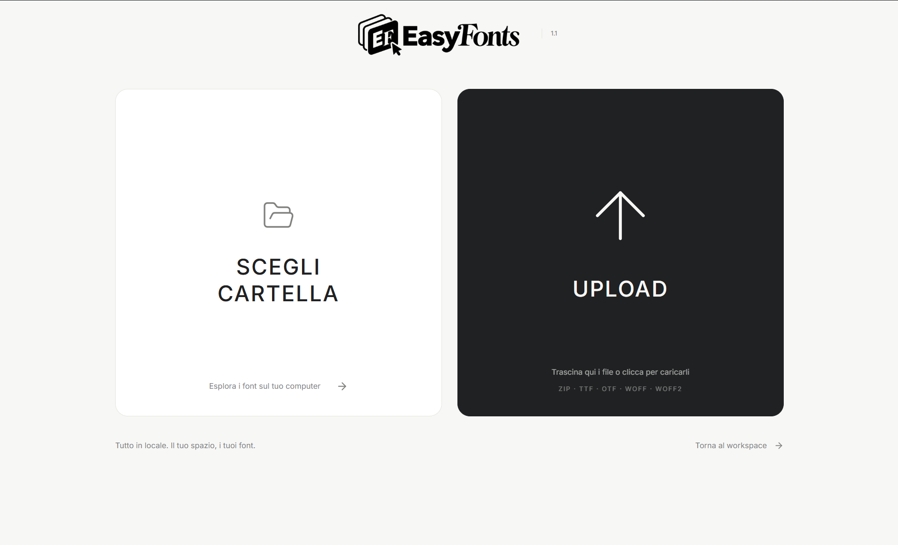
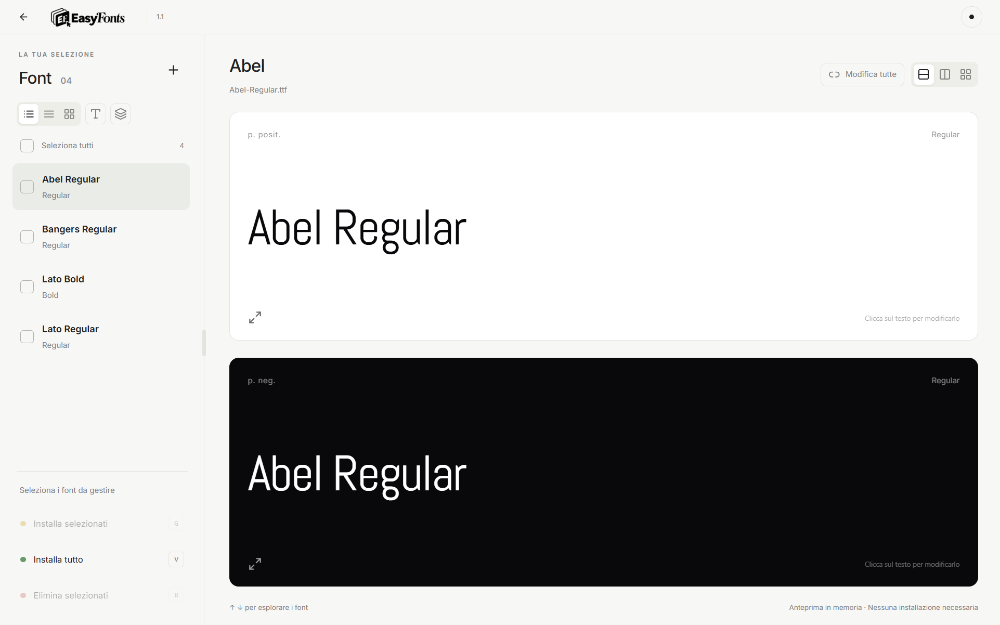

<p align="center"></p>

# EasyFonts

**Meno tempo a gestire font. Più tempo a progettare.**

Un'app desktop locale e open source per designer grafici e creativi: prova i font prima di installarli, confronta le varianti e tieni le licenze insieme ai file.

**Versione 1.1 · Windows x64 · Licenza MIT**

Scarichi una famiglia tipografica, apri uno ZIP pieno di file, cerchi la licenza e installi varianti solo per capire se funzionano nel progetto. EasyFonts riunisce questi passaggi in uno spazio di lavoro: carichi, provi, confronti e installi quello che ti serve.

L'app funziona sul tuo computer, senza account, chiavi API o servizi cloud. I font si provano in memoria: non devi installarli per vederli.

## Parti da una cartella o da uno ZIP

La schermata qui sopra offre due ingressi. **Scegli cartella** apre il selettore nativo e analizza font, archivi e documenti di licenza anche nelle sottocartelle. **Upload** permette di scegliere o trascinare uno o più ZIP o singoli file TTF, OTF, WOFF e WOFF2. EasyFonts estrae i font ignorando immagini promozionali, file nascosti e cartelle `__MACOSX`.

Per una prova immediata trascina il [sample-fonts-pack.zip](sample-fonts-pack.zip) incluso: contiene quattro font reali open source — Lato Regular, Lato Bold, Abel e Bangers — con le licenze SIL OFL originali. Non contiene font di una libreria personale.

## Scegli, confronta e scrivi direttamente nelle anteprime



Nello screenshot del workspace sono caricati i font pubblici del sample pack. La lista a sinistra serve per esplorare e selezionare; le due anteprime a destra mostrano il font attivo su bianco e su nero. Il layout corrisponde a quello usato anche con cartelle più grandi.

- **Prova un font con un clic.** Seleziona il nome oppure passa al precedente o al successivo con ↑ e ↓. Puoi scrivere direttamente nell'anteprima senza installare il font.
- **Usa il tuo testo.** Ogni anteprima mostra inizialmente il nome del proprio font. Se modifichi un testo, cambia solo quella specifica anteprima; attiva **Modifica tutte** per usare lo stesso testo in tutte le preview. Disattivandolo ritrovi i testi individuali.
- **Confronta positivo e negativo.** Le due aree rendono visibili leggibilità, peso e carattere sui due sfondi. L'icona in basso a sinistra apre la preview a schermo intero, con dimensione regolabile, vista B/W e confronto tra i font selezionati.
- **Passa tra gli stili.** Il raggruppamento opzionale riunisce le varianti della stessa famiglia. Espandi la famiglia oppure usa i selettori nelle anteprime e nelle card per passare tra Regular, Bold, Italic e altri stili disponibili.

## Organizza lo spazio come ti serve

Trascina il divisore centrale per dare più spazio alla lista o alle anteprime. La lista offre **elenco, vista compatta e griglia**; le card della griglia mostrano la preview, il nome sotto e i relativi controlli. Puoi attivare con un clic i **nomi disegnati nel proprio font** e il **raggruppamento per famiglia**.

Anche le preview offrono disposizione **impilata, affiancata e a griglia**, utile per confrontare più font. L'archivio licenze ha a sua volta viste elenco, compatta e griglia. Le viste della lista e delle preview si scelgono separatamente.

Dal menu in alto a destra puoi passare istantaneamente tra tema chiaro e scuro. Al riavvio ritrovi l'ultima cartella o lista, il tema, le viste, il font attivo, la larghezza dei pannelli e i testi personalizzati. Se una cartella non è più disponibile, l'app mostra le copie conservate e un avviso.

## Installa ciò che scegli, pulisci con controllo

Usa i checkbox per selezionare singoli font o intere famiglie. **Seleziona tutti** include tutti i font gestibili della lista, escludendo quelli protetti.

| Azione               | Scorciatoia | Risultato                                                            |
| -------------------- | ----------- | -------------------------------------------------------------------- |
| Installa selezionati | `G`         | Installa i font spuntati e conserva le relative licenze              |
| Installa tutto       | `V`         | Installa tutti i font della lista                                    |
| Elimina selezionati  | `R`         | Chiede conferma e rimuove i font selezionati, con copia recuperabile |

Le scorciatoie restano inattive mentre scrivi e nei dialoghi. L'installazione usa la cartella font dell'utente. Dal menu in alto a destra, **Tutti i font del PC** carica i font installati: puoi ispezionarli e rimuovere quelli gestibili nella cartella utente. Font essenziali e directory globali del sistema sono protetti nel backend e indicati con un lucchetto.

**Il contesto conta quando elimini:** in modalità cartella viene rimosso il file originale selezionato; per un upload viene rimossa la copia nella libreria di EasyFonts; in modalità PC viene disinstallato il font utente. Lo ZIP di origine non viene riscritto. Prima della rimozione l'app conserva una copia nel proprio `trash/`; il [manuale](docs/USAGE.md) spiega come recuperarla.

## Tieni le licenze vicino ai font

**Gestione licenze**, nel menu in alto a destra, raccoglie documenti TXT, MD, PDF, LICENSE, OFL e README trovati negli archivi o nelle cartelle, insieme ai metadati interni del font. Puoi filtrare l'archivio e consultare i documenti salvati anche dopo aver rimosso un font.

Le categorie commerciale, personale e **Da verificare** sono indicazioni ricavate dal testo disponibile. Non certificano i diritti d'uso: leggi sempre la licenza originale. I PDF si possono consultare, ma non vengono convertiti automaticamente in testo. La licenza MIT di EasyFonts non si applica ai font che importi.

## Avvio dai sorgenti

Servono **Node.js 24 LTS**, npm e Git. La versione desktop verificata è Windows x64.

```sh
npm ci
npm run dev
```

Si apre una finestra Electron: non serve aprire un browser o configurare porte. Per creare l'eseguibile portabile:

```sh
npm run dist
```

Trovi `EasyFonts.exe`, il sample pack, gli avvisi di licenza e il checksum in `release/`. L'eseguibile non è firmato digitalmente. La modalità browser `npm run dev:web` è disponibile per sviluppo. Le integrazioni con le cartelle font macOS/Linux sono presenti nel codice, ma questa release è stata verificata e impacchettata su Windows.

## Dati, architettura e verifiche

La libreria, le licenze e le preferenze rimangono locali e sono escluse dalla repository. Su Windows i dati desktop sono in `%APPDATA%\EasyFonts\library`. Nessuna telemetria è implementata. Leggi [Privacy](PRIVACY.md) e [Sicurezza](SECURITY.md) per i dettagli.

Il frontend usa React, TypeScript, Vite, Tailwind CSS, Framer Motion e lucide-react. Electron gestisce finestra e selettori nativi; il backend Node/Express gestisce file e database JSON; opentype.js e wawoff2 leggono e convertono i font. Il renderer comunica con un backend sul loopback interno con token di sessione.

```sh
npm run check:repo
npm run check:secrets
npm run build
npm test
npm run test:desktop
```

I test usano font pubblici e dati temporanei, verificando importazione, licenze, persistenza, protezioni e interazioni nella UI reale. Non installano o disinstallano font sul computer. La CI è configurata per eseguire questi controlli su Windows; il primo risultato remoto sarà disponibile dopo la pubblicazione.

## Documentazione e contributi

- [Manuale completo](docs/USAGE.md): flussi, percorsi dati, recupero file e limiti.
- [Come contribuire](CONTRIBUTING.md): ambiente, verifiche e gestione dei dati nei contributi.
- [Changelog](CHANGELOG.md): funzioni della versione 1.1.
- [Preparazione del rilascio](docs/RELEASING.md): controlli e distribuzione.
- [Licenza MIT](LICENSE) e [componenti di terze parti](THIRD_PARTY_NOTICES.md).

Gli screenshot usano esclusivamente l'interfaccia e font pubblici di esempio. Il progetto non redistribuisce font personali o commerciali.
